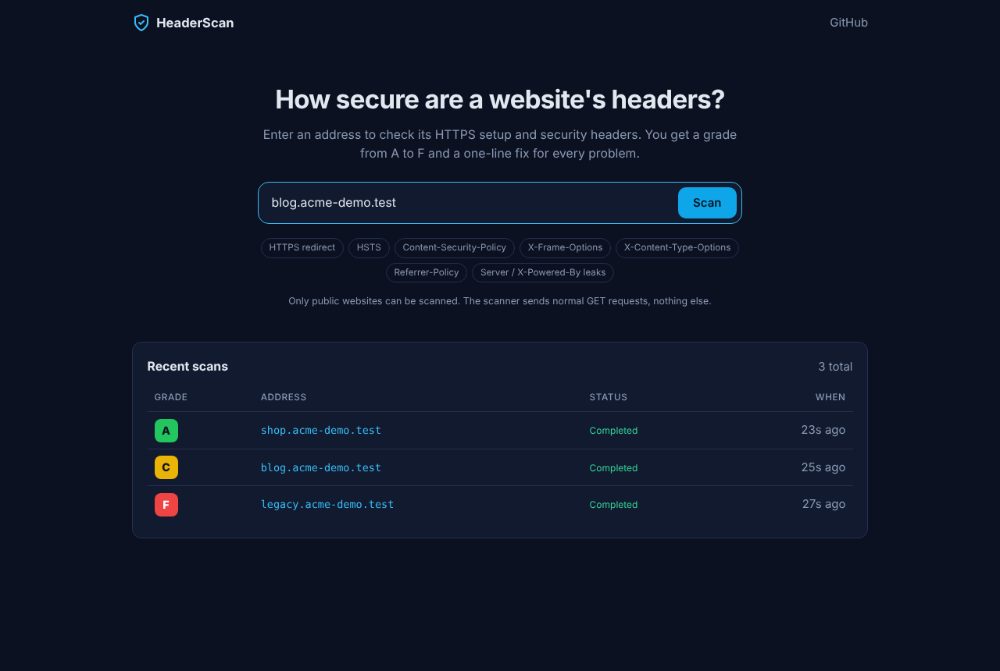
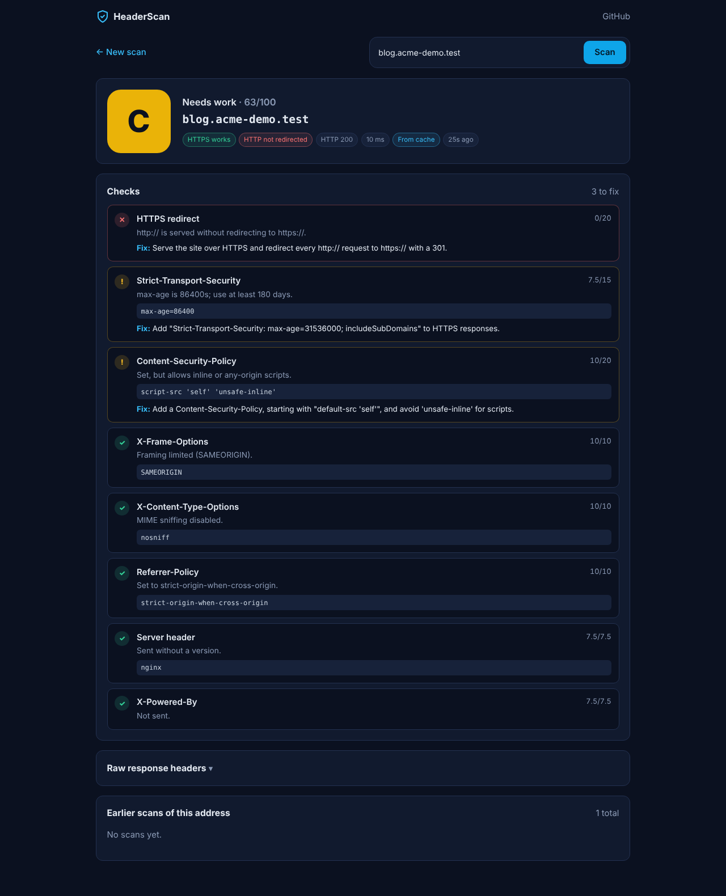
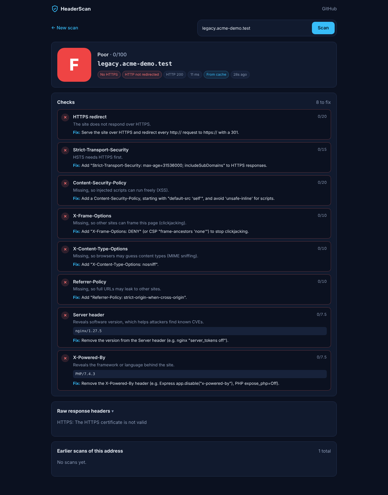

# Security Header Scanner

A MERN app that checks how well a website is protected by its HTTP security headers. Enter an address, and a background worker fetches the site, checks its HTTPS setup and seven headers, and gives it a grade from A to F with a one-line fix for every problem.



| Grade C: needs work | Grade F: legacy site |
| --- | --- |
|  |  |

## Features

- **Background scans with BullMQ.** `POST /api/scans` answers at once with `202 Accepted`; a separate worker container does the scanning and the page polls until the result is ready.
- **Eight checks, one grade.** HTTPS redirect, Strict-Transport-Security, Content-Security-Policy, X-Frame-Options, X-Content-Type-Options, Referrer-Policy, and leaks in `Server` and `X-Powered-By`. Each check passes, warns (half points) or fails, with a one-line fix. The weighted total gives A (90+), B (75+), C (60+), D (45+) or F.
- **Redis cache.** The same address scanned again within 10 minutes is answered from Redis (`200`, `X-Cache: HIT`, "From cache" in the UI) without touching the site again. Two people scanning the same address at once share one job.
- **Redis rate limit.** 10 scans per minute per IP. The 11th gets `429 Too Many Requests` with `Retry-After`.
- **History in MongoDB.** Every scan is saved; the home page lists recent scans and each result shows earlier scans of the same address.
- **Safe by design.** The scanner refuses private and reserved IP addresses (SSRF protection) and only ever sends plain `GET` requests.

## Tech stack

| Layer | Tools |
| --- | --- |
| Frontend | React 18, Vite, React Router, Redux Toolkit, RTK Query |
| Backend | Node.js 22, Express 5, Mongoose, express-validator, helmet |
| Queue and HTTP | BullMQ, ioredis, undici |
| Data | MongoDB 7, Redis 7 |
| Infra | Docker, Docker Compose, nginx, GitHub Actions |
| Tests | node:test + supertest (API and scanner), Vitest + Testing Library (client) |

## Run it

You need Docker Desktop (or Docker Engine with Compose). Then:

```bash
git clone https://github.com/huzaib123/Security-Header-Scanner.git
cd Security-Header-Scanner
docker compose up --build
```

Open **http://localhost:8090** and scan any public site, for example `github.com`.

That starts five containers: `client` (nginx on port 8090), `server` (API on port 5060), `worker` (the scanner), `mongo` and `redis`. If a port is taken on your machine, pick others: `CLIENT_PORT=8091 API_PORT=5061 docker compose up`. To change other settings, copy `.env.example` to `.env` first.

### Local development without Docker

```bash
docker compose up mongo redis        # add ports 27017 and 6379 in docker-compose.yml, or use local installs

cd server && cp ../.env.example .env # set MONGO_URI=mongodb://127.0.0.1:27017/shs and REDIS_URL=redis://127.0.0.1:6379
npm install
npm run dev                          # API on :5060
npm run dev:worker                   # in a second terminal

cd client && npm install && npm run dev   # UI on :3000, proxies /api to :5060
```

## API

| Method | Route | Purpose | Responses |
| --- | --- | --- | --- |
| POST | `/api/scans` | Start a scan. Body: `{ "url": "example.com" }` | `202` queued (with `Location`), `200` from cache, `400` bad or blocked address, `429` rate limited |
| GET | `/api/scans/:id` | Read one scan; poll until `status` is `completed` or `failed` | `200`, `404` |
| GET | `/api/scans?url=&page=&limit=` | Scan history, newest first, optionally for one address | `200` |
| GET | `/api/health` | Health check | `200` |

Try it from a terminal:

```bash
curl -i -X POST localhost:5060/api/scans -H 'Content-Type: application/json' -d '{"url":"github.com"}'
curl localhost:5060/api/scans/<id>
```

Errors always look like `{ "error": { "message": "..." } }`.

## How it works

```
Browser ──POST /api/scans──▶ API ──┬─ cached in Redis? ──▶ 200 + result
                                   ├─ already running?  ──▶ 202 + same scan id
                                   └─ save in MongoDB, add job to BullMQ ──▶ 202 + scan id
                                                   │
                                   Worker ◀────────┘  fetch http:// and https://, run checks,
                                     │                save result in MongoDB, cache it in Redis
Browser ──GET /api/scans/:id every second──▶ API ──▶ MongoDB
```

### Queue and worker

The API never fetches a website itself. It saves a `queued` scan and adds a BullMQ job whose id is the scan id, so a job can never be added twice. The worker runs in its own container from the same image (`node src/worker.js`), takes up to 5 jobs at a time, marks the scan `running`, and saves the result. Network errors are retried once with exponential backoff; a blocked or invalid address fails at once because retrying cannot help. If the worker crashes mid-scan, BullMQ notices the stalled job and hands it to another worker.

### Cache and in-flight dedupe

Addresses are normalised (scheme added, host lower-cased) into a cache key. A finished result is stored at `shs:result:<key>` for `SCAN_CACHE_TTL` seconds (600). While a scan is running, `SET NX` on `shs:inflight:<key>` makes a second request for the same address return the running scan instead of starting a new one.

### Rate limit

A fixed one-minute window per client IP: `INCR` and `EXPIRE` on `shs:ratelimit:<ip>:<window>` inside one `MULTI`. The response carries `RateLimit-Limit`, `RateLimit-Remaining` and `RateLimit-Reset` headers. Because the count lives in Redis, the limit holds across several API containers. Express trusts one proxy hop so the limit applies to the real client IP behind nginx. If Redis is down the limiter lets requests through rather than taking the site offline.

### SSRF protection

A scanner that fetches any URL a user types could be pointed at `http://169.254.169.254/` (cloud metadata) or `http://localhost:6379` (our own Redis). To stop that:

- Only `http` and `https` on ports 80 and 443, no usernames or passwords in the URL, and no `localhost` or `.internal` names.
- Every IP is checked against a block list of private, loopback, link-local, CGNAT, multicast and reserved ranges, for IPv4, IPv6 and IPv4-mapped IPv6.
- The check runs inside the HTTP client's DNS lookup, at connection time. That covers every redirect hop and stops DNS rebinding, where a name resolves to a public IP when checked and a private IP when fetched.
- Requests are plain `GET`s with a 10-second timeout, at most 5 redirects, and response bodies are thrown away after 64 KB.

### Grading

| Check | Points | Pass when |
| --- | --- | --- |
| HTTPS redirect | 20 | HTTPS works and `http://` redirects to `https://` |
| Strict-Transport-Security | 15 | `max-age` of at least 180 days |
| Content-Security-Policy | 20 | Enforced, and scripts not opened up by `unsafe-inline` or `*` |
| X-Frame-Options | 10 | `DENY` or `SAMEORIGIN`, or CSP `frame-ancestors` |
| X-Content-Type-Options | 10 | `nosniff` |
| Referrer-Policy | 10 | A policy that does not leak full URLs cross-origin |
| Server | 7.5 | Absent or without a version number |
| X-Powered-By | 7.5 | Absent |

A warning scores half the points.

## Tests

```bash
cd server && npm test   # needs MongoDB on 127.0.0.1:27017 and Redis on 127.0.0.1:6379
cd client && npm test
```

The 41 server tests run against real MongoDB and Redis and local HTTP and HTTPS test sites. They cover every header check and grade boundary, the SSRF block list (including IPv6 and IPv4-mapped addresses and redirects to private IPs), the full queue-to-worker flow, the second scan coming from cache, the 11th scan in a minute getting `429`, and history filtering. GitHub Actions runs both suites and the Docker build on every push.

## Project structure

```
client/                      React app (Vite) served by nginx in Docker
  src/services/api.js        RTK Query endpoints (scan, poll, history)
  src/features/scanSlice.js  form state
  src/pages/                 Home (form + history), Scan (live result)
server/
  src/scanner/               ssrfGuard, normalizeUrl, runScan, headerChecks
  src/services/              BullMQ queue, Redis cache, processScan
  src/middleware/            Redis rate limit, validation, errors
  src/worker.js              worker entry point
  src/server.js              API entry point
  tests/                     integration and unit tests
docker-compose.yml           client, server, worker, mongo, redis
```
